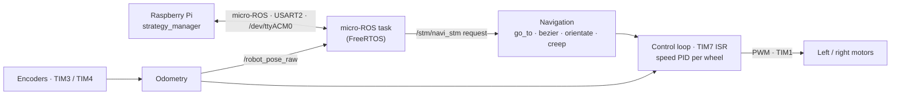

# Navigation_MicroROS_2026 — STM32 drive controller

Firmware for the **STM32 Nucleo-F446RE** board that drives the main EUROBOT 2026 robot. It runs the wheel speed loops, tracks the robot's position, follows trajectories (straight lines, turns, Bézier curves), and detects collisions. The Raspberry Pi controls it through **micro-ROS** over USB serial.

Part of the [AEROBOTIX INSAT EUROBOT 2026](https://github.com/Eurobot-2026-Aerobotix) robot. High-level decisions are made in [ROS2-WS-EURO](https://github.com/Eurobot-2026-Aerobotix/ROS2-WS-EURO).

## What it does



- **Motion primitives:** go to (x, y) forward or backward, cubic Bézier curves, orientate to an absolute heading, *creep* (slow approach for docking against game elements), emergency brake, and reset.
- **Speed control:** one PI controller per wheel (the D term is disabled because it is too noisy at this rate), output smoothing, and integral anti-windup. Acceleration and braking follow a ramped speed profile.
- **Localisation:** encoder odometry; heading comes from the left/right encoder difference over the tracking-wheel spacing (`Odometry.c`). A BNO055 IMU driver and an EKF scaffold (`IMU.c`, `EKF.c`) are included, but the IMU is not yet fused into the pose. The Pi can re-anchor the pose with `set_position` or from ArUco tag observations (`fix x and y`).
- **Collision detection:** if the PWM is near its maximum while the robot is almost stopped (`STOP_PWM_THRESHOLD`, `STOP_SPEED_THRESHOLD` in `Motors.h`), the robot is considered blocked and the Pi can query it (command 18).
- **Robust link:** a state machine (`AGENT_WAIT → AVAILABLE → CONNECTED → DISCONNECTED`) pings the agent and recreates all ROS entities when the Pi or the agent restarts, so the board never needs a manual reset.

## ROS interface

Node name: `cubemx_node`

| Name | Type | Direction | Content |
|---|---|---|---|
| `/robot_pose_raw` | `geometry_msgs/Vector3` | published | `x`, `y` in metres, `z` = heading |
| `/debug` | `std_msgs/String` | published | packed status: `status + 100·loop_state + 10000·heading(deg)` |
| `/stm/navi_stm` | `service/NaviStm` | service | motion commands (below) |

### `/stm/navi_stm` commands

`NaviStm.srv` has ten `float32` fields (`arg1` … `arg10`) and returns `bool result`. `arg1` selects the command:

| `arg1` | Command | Arguments (`arg2` …) |
|---|---|---|
| 4 | Orientate | heading, is_radian, is_smooth |
| 5 | Go to | x, y, speed, is_smooth |
| 6 | Reset | — |
| 10 | Emergency brake | — |
| 11 | Is idle? | — (result = idle) |
| 12 | Go to, backwards | x, y, speed, is_smooth |
| 13 | Bézier curve | x1, y1, x2, y2, x3, y3, speed, is_smooth |
| 14 | Bézier curve, backwards | same as 13 |
| 15 | Set position | x, y, heading |
| 16 | Idle or destination reached? | — |
| 17 | Fix x and y | source (0 = raw, 1 = front ArUco, 2 = back ArUco), x, y |
| 18 | Stopped by collision? | — |
| 19 | Shutdown motors | — |
| 20 | Creep to | x, y |
| 21 | Creep to, backwards | x, y |

Any other value returns `false`. Distances are in millimetres and speeds in mm/s.

Quick test from the Pi:

```bash
ros2 run micro_ros_agent micro_ros_agent serial --dev /dev/ttyACM0 -b 115200
ros2 service call /stm/navi_stm service/srv/NaviStm "{arg1: 5.0, arg2: 500.0, arg3: 300.0, arg4: 400.0}"
ros2 topic echo /robot_pose_raw
```

The `service` interface package comes from [ROS2-WS-EURO](https://github.com/Eurobot-2026-Aerobotix/ROS2-WS-EURO/tree/main/src/service), so build that workspace first.

## Hardware

| Peripheral | Use |
|---|---|
| STM32 Nucleo-F446RE | Main MCU (STM32F446RE), FreeRTOS |
| USART2 + DMA | micro-ROS transport, seen as `/dev/ttyACM0` on the Pi |
| TIM1 | Motor PWM (period 4500) |
| TIM3, TIM4 | Quadrature encoders, left and right |
| TIM5 | Microsecond timebase |
| TIM7 | Control-loop interrupt |
| I2C1 | BNO055 IMU (driver present, not fused yet) |

Pin assignments are in [`Navigation_MicroROS_2026.ioc`](Navigation_MicroROS_2026.ioc).

## Code map

| File | Content |
|---|---|
| `Core/Src/main.c` | Peripheral setup, FreeRTOS tasks, micro-ROS state machine, `/stm/navi_stm` callback, TIM7 control loop |
| `Core/Src/micro_ros.c` | Creation and teardown of the node, publishers, and service |
| `Core/Src/navigation.c` | Motion primitives, speed profiles, emergency brake |
| `Core/Src/Odometry.c` | Pose integration, Bézier geometry, unit conversions |
| `Core/Src/EKF.c`, `IMU.c` | BNO055 driver and EKF scaffold (not used for the pose yet) |
| `Core/Src/Motors.c` | PWM output and stall detection |
| `extra_sources/` | micro-ROS transports, allocators, and time source |
| `libmicroros/` | Pre-built micro-ROS static library and headers |

## Build and flash

The project is generated with **STM32CubeMX** and uses the [micro_ros_stm32cubemx_utils](https://github.com/micro-ROS/micro_ros_stm32cubemx_utils) pre-built library (already in `libmicroros/`).

1. Open the folder in **STM32CubeIDE** (*File → Open Projects from File System*).
2. Build the `Debug` configuration.
3. Flash over the Nucleo's ST-LINK.

The tuning gains (`kpS_R`, `kiS_R`, `kdS_R`, and their left-wheel equivalents) are at the top of `Core/Src/main.c`.

## Branches

`main` is the competition firmware. The other branches (`dev`, `fail_safe`, `freertos_debugging`, `old_robot`, ...) are experiments kept for reference.

## Safety

Test with the wheels lifted first. Keep the emergency stop within reach and limit speed while tuning gains.
